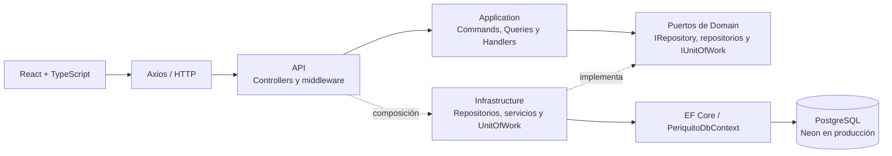
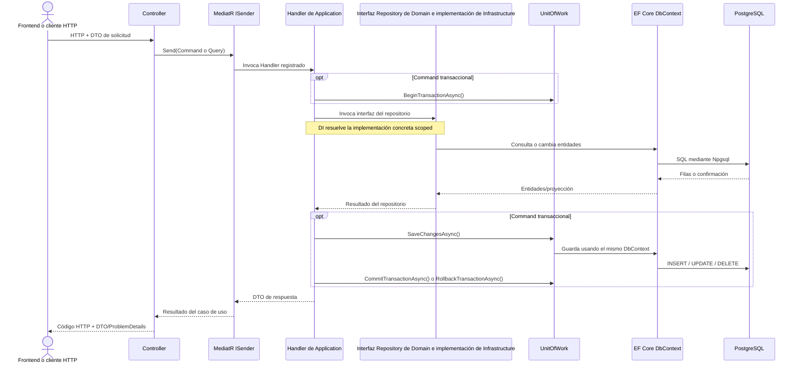

# PeriquitoManagement

Sistema web para administrar la operación del Restaurante Periquito. Reúne en una API ASP.NET Core y una interfaz React la gestión de categorías, platos, mesas, pedidos, ventas, usuarios, inventario y reportes.

- **Backend:** ASP.NET Core 10 y PostgreSQL.
- **Frontend:** React, Vite y TypeScript.
- **Producción:** Render y Neon.
- **Autor:** Julio Torres.

## Índice

- [Problemática](#problemática)
- [Propuesta de solución](#propuesta-de-solución)
- [Objetivos](#objetivos)
- [Funcionalidades](#funcionalidades)
- [Tecnologías](#tecnologías)
- [Arquitectura hexagonal](#arquitectura-hexagonal)
  - [Flujo completo de una solicitud](#flujo-completo-de-una-solicitud)
  - [Criterios técnicos y evidencia](#criterios-técnicos-y-evidencia)
  - [Estructura del repositorio](#estructura-del-repositorio)
- [Datos y modelo entidad-relación](#datos-y-modelo-entidad-relación)
- [Autenticación, roles y seguridad](#autenticación-roles-y-seguridad)
- [API y endpoints](#api-y-endpoints)
- [Reglas de negocio](#reglas-de-negocio)
- [Tickets y cálculo de efectivo](#tickets-y-cálculo-de-efectivo)
- [Reportes Excel](#reportes-excel)
- [Capturas de pantalla](#capturas-de-pantalla)
- [Configuración del entorno local](#configuración-del-entorno-local)
- [Docker, Render y Neon](#docker-render-y-neon)
- [Correcciones de despliegue](#correcciones-de-despliegue)
- [Verificaciones locales y de producción](#verificaciones-locales-y-de-producción)
- [Limitaciones del alojamiento gratuito](#limitaciones-del-alojamiento-gratuito)
- [Conclusiones](#conclusiones)

## Problemática

La operación del restaurante necesita mantener coordinados los datos de mesas, pedidos, platos, ventas e insumos. Cuando estas tareas se gestionan por separado, es más difícil consultar el estado de una mesa, dar seguimiento a un pedido, conservar los importes históricos o revisar los resultados de ventas e inventario.

## Propuesta de solución

PeriquitoManagement centraliza estas operaciones en una aplicación web con permisos diferenciados para Administrador y Mesero. Una API organizada por capas aplica las reglas de negocio y persiste los datos en PostgreSQL; el frontend ofrece un panel para cada rol y consulta la API mediante HTTP.

## Objetivos

### Objetivo general

Desarrollar un sistema para centralizar y facilitar la gestión operativa del Restaurante Periquito, con información persistente y acceso controlado por roles.

### Objetivos específicos

- Administrar categorías, platos, mesas y cuentas de usuario.
- Registrar pedidos y completar ventas conservando precios y costos históricos.
- Controlar insumos y movimientos de inventario.
- Presentar indicadores administrativos y exportar reportes de ventas a Excel.
- Permitir al personal Mesero atender mesas y pedidos sin acceder a costos ni operaciones administrativas.
- Mantener separadas las reglas de aplicación, el dominio, la persistencia y la interfaz de usuario.

## Funcionalidades

### Administrador

- Consultar el dashboard con ventas, ganancias, costos, pedidos, mesas, inventario y platos más vendidos para un rango de fechas.
- Crear, editar, consultar y eliminar categorías, platos, mesas e insumos, sujeto a las relaciones e historial existentes.
- Activar o desactivar platos.
- Consultar pedidos, sus detalles y datos de costo.
- Consultar ventas, incluyendo mesa, mesero, platos, precios y costos históricos.
- Consultar e imprimir tickets internos desde el historial de ventas.
- Registrar entradas y salidas de inventario, consultar movimientos y detectar insumos con stock bajo.
- Crear y administrar usuarios con roles Administrador o Mesero.
- Descargar el reporte de ventas en formato Excel.

### Mesero

- Consultar categorías, carta de platos y precios de venta, sin recibir costos en esos DTOs.
- Consultar mesas, mesas disponibles, pedidos activos y pedidos asociados a una mesa.
- Abrir pedidos, agregar o ajustar platos, quitar elementos, cancelar pedidos y completar la venta.
- Ver, imprimir o guardar como PDF el ticket interno al completar una venta; calcular el vuelto de forma auxiliar sin registrar pagos.
- Consultar su perfil de sesión.

## Tecnologías

| Área | Tecnologías |
|---|---|
| API | .NET 10, ASP.NET Core Web API, C# |
| Persistencia | Entity Framework Core 10, Npgsql 10, PostgreSQL |
| Aplicación | MediatR 12.5.0 |
| Autenticación | JWT Bearer, `PasswordHasher<TUser>` de ASP.NET Core Identity |
| Documentación de API | Swashbuckle.AspNetCore 10.3.1 (Swagger UI en Development) |
| Excel | ClosedXML 0.105.1 |
| Frontend | React 19, Vite 8, TypeScript 7 |
| Interfaz | Tailwind CSS 4, React Router 7, Lucide React, Recharts, Sonner |
| HTTP | Axios |
| Contenedores y hosting | Docker multi-stage, Render |
| Base de datos administrada | Neon PostgreSQL |

Las versiones corresponden a los archivos de proyecto y manifiestos incluidos en este repositorio.

## Arquitectura hexagonal

El backend separa las reglas y los adaptadores. El dominio contiene entidades, constantes y puertos de persistencia; Application agrupa casos de uso, DTOs e interfaces; Infrastructure implementa repositorios, servicios y persistencia; Api expone HTTP y ensambla las dependencias. La API es el punto de composición y referencia Application e Infrastructure. Infrastructure referencia Domain y Application para implementar los puertos correspondientes.



### Patrones y flujo de aplicación

- **Repository:** las interfaces se declaran en Domain y sus implementaciones concretas consultan y modifican PostgreSQL desde Infrastructure. Los repositorios especializados añaden consultas de categorías, usuarios, pedidos, ventas, mesas e inventario.
- **UnitOfWork:** coordina `SaveChangesAsync` y transacciones explícitas; los casos de uso que necesitan atomicidad confirman o revierten la transacción.
- **Commands, Queries y Handlers:** MediatR dirige cada solicitud a su Handler. Los Commands modifican el estado; los Queries devuelven proyecciones DTO. Los grupos funcionales se encuentran en `Application/UseCases`.
- **Controllers:** validan el contrato HTTP, aplican autorización y delegan la operación a MediatR. No acceden directamente al `DbContext`.
- **Middleware:** `ExceptionMiddleware` produce respuestas `ProblemDetails`; `RequestLoggingMiddleware` registra método, plantilla de ruta, código HTTP y duración, sin registrar cuerpos de solicitud ni credenciales.

### Flujo completo de una solicitud

En el registro de dependencias, los repositorios, `UnitOfWork` y `PeriquitoDbContext` se configuran como `scoped`. El Handler y sus adaptadores reciben, por tanto, el mismo contexto durante una solicitud. Una consulta hace el recorrido hasta PostgreSQL y devuelve el DTO; una operación de escritura añade al recorrido los cambios y, cuando la regla lo requiere, una transacción con confirmación o rollback.



En las escrituras transaccionales el Handler inicia la transacción antes de confirmar los cambios; `SaveChangesAsync` no equivale a `CommitTransactionAsync`. `UnitOfWork` libera la transacción y limpia el `ChangeTracker` al revertir.

### Criterios técnicos y evidencia

La rúbrica literal del curso no está versionada en este repositorio. Esta tabla relaciona los criterios técnicos y recomendaciones del profesor que se aplicaron durante el desarrollo con los archivos que permiten revisarlos.

| Criterio técnico | Evidencia verificable |
|---|---|
| Separar Api, Application, Domain e Infrastructure y mantener dependencias explícitas | [PeriquitoManagement.sln](PeriquitoManagement.sln), los cuatro `.csproj`, [Program.cs](PeriquitoManagement.Api/Program.cs) y [DependencyInjection.cs](PeriquitoManagement.Api/Configuration/DependencyInjection.cs). |
| Mantener dominio, puertos y entidades del esquema Database First | [schema.sql](database/schema.sql), `PeriquitoManagement.Domain/Entities/`, `PeriquitoManagement.Domain/Interfaces/` y [PeriquitoDbContext.cs](PeriquitoManagement.Infrastructure/Persistence/PeriquitoDbContext.cs). |
| Definir interfaces Repository en Domain e implementarlas en Infrastructure | `PeriquitoManagement.Domain/Interfaces/IRepository.cs`, `ICategoryRepository.cs`, `IOrderRepository.cs` y `ISaleRepository.cs`; implementaciones en `PeriquitoManagement.Infrastructure/Repositories/`. |
| Separar persistencia de transacciones, usar Repository y UnitOfWork | [Repository.cs](PeriquitoManagement.Infrastructure/Repositories/Repository.cs), [UnitOfWork.cs](PeriquitoManagement.Infrastructure/Persistence/UnitOfWork.cs) y [IUnitOfWork.cs](PeriquitoManagement.Domain/Interfaces/IUnitOfWork.cs). |
| Agrupar Commands, Queries y Handlers por funcionalidad | [CategoryUseCases.cs](PeriquitoManagement.Application/UseCases/Categories/CategoryUseCases.cs), [OrderUseCases.cs](PeriquitoManagement.Application/UseCases/Orders/OrderUseCases.cs), [SaleUseCases.cs](PeriquitoManagement.Application/UseCases/Sales/SaleUseCases.cs) y demás archivos funcionales bajo `PeriquitoManagement.Application/UseCases/`. |
| Mantener Controllers delgados, sin acceso directo a DbContext | `PeriquitoManagement.Api/Controllers/`; por ejemplo, [OrdersController.cs](PeriquitoManagement.Api/Controllers/OrdersController.cs) delega mediante `ISender`. |
| Mantener Program.cs como composition root y separar configuración de middleware | [Program.cs](PeriquitoManagement.Api/Program.cs), `PeriquitoManagement.Api/Configuration/` y `PeriquitoManagement.Api/Middleware/`. |
| Implementar autenticación, roles y protección de costos | [AuthController.cs](PeriquitoManagement.Api/Controllers/AuthController.cs), [AuthenticationConfiguration.cs](PeriquitoManagement.Api/Configuration/AuthenticationConfiguration.cs), [PasswordService.cs](PeriquitoManagement.Infrastructure/Services/PasswordService.cs), controladores con `[Authorize]` y DTOs separados de platos/pedidos. |
| Aplicar reglas transaccionales para pedidos, ventas e inventario | [OrderUseCases.cs](PeriquitoManagement.Application/UseCases/Orders/OrderUseCases.cs), [SaleUseCases.cs](PeriquitoManagement.Application/UseCases/Sales/SaleUseCases.cs), [InventoryMovementUseCases.cs](PeriquitoManagement.Application/UseCases/Inventory/InventoryMovementUseCases.cs) y [schema.sql](database/schema.sql). |
| Manejar errores y registrar solicitudes sin datos sensibles | [ExceptionMiddleware.cs](PeriquitoManagement.Api/Middleware/ExceptionMiddleware.cs) y [RequestLoggingMiddleware.cs](PeriquitoManagement.Api/Middleware/RequestLoggingMiddleware.cs). |
| Desplegar sin incluir secretos ni depender del sistema de archivos local | [Dockerfile](Dockerfile), [.dockerignore](.dockerignore), [render.yaml](render.yaml) y `BootstrapUsers` en Render. |

### Estructura del repositorio

```text
PeriquitoManagement/
├── PeriquitoManagement.Api/
│   ├── Configuration/
│   ├── Controllers/
│   ├── Middleware/
│   ├── Program.cs
│   └── PeriquitoManagement.Api.http
├── PeriquitoManagement.Application/
│   ├── DTOs/
│   ├── Exceptions/
│   ├── Interfaces/
│   └── UseCases/
├── PeriquitoManagement.Domain/
│   ├── Constants/
│   ├── Entities/
│   ├── Interfaces/
│   └── ReadModels/
├── PeriquitoManagement.Infrastructure/
│   ├── Persistence/
│   ├── Repositories/
│   └── Services/
├── database/
│   ├── schema.sql
│   ├── seed.sql
│   ├── seed-production.sql
│   ├── verify-production.sql
│   └── queries.sql
├── periquito-frontend/
│   └── src/
│       ├── components/
│       ├── context/
│       ├── hooks/
│       ├── layouts/
│       ├── pages/admin/
│       ├── pages/waiter/
│       ├── routes/
│       ├── services/
│       ├── types/
│       └── utils/
├── Dockerfile
├── .dockerignore
├── render.yaml
└── PeriquitoManagement.sln
```

## Datos y modelo entidad-relación

La base sigue un enfoque **Database First**: `database/schema.sql` define las tablas, restricciones, índices, función y trigger; las entidades y `PeriquitoDbContext` representan ese esquema en EF Core. Las diez tablas son `roles`, `users`, `categories`, `dishes`, `tables`, `orders`, `order_details`, `sales`, `ingredients` e `inventory_movements`.

```mermaid
erDiagram
    ROLES ||--o{ USERS : asigna
    USERS ||--o{ ORDERS : atiende
    TABLES o|--o{ ORDERS : recibe
    CATEGORIES ||--o{ DISHES : clasifica
    ORDERS ||--o{ ORDER_DETAILS : contiene
    DISHES ||--o{ ORDER_DETAILS : aparece_en
    ORDERS ||--o| SALES : genera
    INGREDIENTS ||--o{ INVENTORY_MOVEMENTS : registra
    USERS o|--o{ INVENTORY_MOVEMENTS : efectua

    ROLES {
        bigint id PK
        varchar name UK
    }
    USERS {
        bigint id PK
        bigint role_id FK
        varchar full_name
        varchar username UK
        varchar password_hash
        boolean is_active
        timestamptz created_at
    }
    CATEGORIES {
        bigint id PK
        varchar name UK
        boolean is_active
    }
    DISHES {
        bigint id PK
        bigint category_id FK
        varchar name UK
        varchar description
        numeric price
        numeric cost
        boolean is_available
    }
    TABLES {
        bigint id PK
        smallint table_number UK
        smallint capacity
        varchar status
    }
    ORDERS {
        bigint id PK
        bigint table_id FK
        bigint waiter_id FK
        timestamptz ordered_at
        timestamptz closed_at
        varchar status
        numeric total
        varchar notes
    }
    ORDER_DETAILS {
        bigint id PK
        bigint order_id FK
        bigint dish_id FK
        integer quantity
        numeric unit_price
        numeric unit_cost
        numeric subtotal
    }
    SALES {
        bigint id PK
        bigint order_id FK_UK
        timestamptz sold_at
        numeric total_amount
        numeric gross_profit
    }
    INGREDIENTS {
        bigint id PK
        varchar name UK
        varchar unit_of_measure
        numeric current_stock
        numeric minimum_stock
        boolean is_active
    }
    INVENTORY_MOVEMENTS {
        bigint id PK
        bigint ingredient_id FK
        bigint user_id FK
        varchar movement_type
        numeric quantity
        timestamptz occurred_at
        varchar reason
    }
```

Los pedidos conservan `unit_price` y `unit_cost` al agregarse un plato, y el detalle calcula su subtotal con el precio histórico. Una venta se relaciona de manera única con el pedido completado. Los movimientos de inventario quedan registrados en `inventory_movements`; el trigger de PostgreSQL ajusta el stock y rechaza una salida que lo dejaría por debajo de cero.

## Autenticación, roles y seguridad

- `POST /api/auth/login` valida que la cuenta exista, esté activa y tenga contraseña correcta; la API emite un JWT firmado con identificador, nombre de usuario y rol.
- `GET /api/auth/me` devuelve la identidad del token actual.
- Las contraseñas se guardan como hashes generados y verificados con `PasswordHasher<User>`; no se almacenan en texto plano.
- Los roles de la base son `Administrador` y `Mesero`. La API impone autorización además de las rutas protegidas del frontend.
- Los endpoints de ventas, dashboard, reportes, usuarios e inventario restringen sus consultas sensibles al Administrador. El Mesero no recibe campos de costo en los DTOs de platos y pedidos.
- El token del frontend se conserva solo en memoria: se pierde al recargar o cerrar la página. No se persiste en `localStorage`.
- CORS admite el origen del frontend configurado para el servicio; no se recomienda usar comodines en producción.
- Las excepciones internas no se devuelven al cliente. Las respuestas de error utilizan `ProblemDetails` y estados HTTP apropiados.

Los secretos se suministran mediante **User Secrets** en desarrollo o variables de entorno en Render. No se deben guardar en Git, `appsettings.json`, `render.yaml`, Dockerfile ni variables `VITE_*`.

## API y endpoints

La API utiliza el prefijo `/api`. `Público` significa sin token; `Autenticado` requiere JWT. Los roles se aplican en el backend. En los endpoints de consulta de pedidos, el Controller selecciona el DTO según el rol: el Mesero recibe información de operación sin costos.

| Módulo | Método | Ruta | Roles autorizados | Descripción |
|---|---|---|---|---|
| Salud | GET | `/api/health` | Público | Comprueba conexión con PostgreSQL; devuelve estado conectado o HTTP 503. |
| Autenticación | POST | `/api/auth/login` | Público | Autentica usuario y contraseña, devuelve JWT. |
| Autenticación | GET | `/api/auth/me` | Administrador, Mesero | Devuelve la identidad y rol del token. |
| Categorías | GET | `/api/categories` | Administrador, Mesero | Lista categorías. |
| Categorías | GET | `/api/categories/{id}` | Administrador, Mesero | Consulta una categoría. |
| Categorías | POST | `/api/categories` | Administrador | Crea categoría. |
| Categorías | PUT | `/api/categories/{id}` | Administrador | Actualiza categoría. |
| Categorías | DELETE | `/api/categories/{id}` | Administrador | Elimina categoría si no tiene platos relacionados. |
| Platos | GET | `/api/dishes` | Administrador, Mesero | Lista; filtros opcionales `categoryId` e `isAvailable`. El DTO del Mesero omite costo. |
| Platos | GET | `/api/dishes/{id}` | Administrador, Mesero | Consulta plato; el DTO del Mesero omite costo. |
| Platos | POST | `/api/dishes` | Administrador | Crea plato. |
| Platos | PUT | `/api/dishes/{id}` | Administrador | Actualiza plato. |
| Platos | PATCH | `/api/dishes/{id}/availability` | Administrador | Recibe un booleano JSON para cambiar disponibilidad. |
| Platos | DELETE | `/api/dishes/{id}` | Administrador | Elimina solo si no se lo impide el historial. |
| Mesas | GET | `/api/tables` | Administrador, Mesero | Lista; filtro opcional `status`. |
| Mesas | GET | `/api/tables/available` | Administrador, Mesero | Lista mesas disponibles. |
| Mesas | GET | `/api/tables/occupied` | Administrador, Mesero | Lista mesas ocupadas. |
| Mesas | GET | `/api/tables/{id}` | Administrador, Mesero | Consulta mesa. |
| Mesas | POST | `/api/tables` | Administrador | Crea mesa. |
| Mesas | PUT | `/api/tables/{id}` | Administrador | Actualiza número/capacidad, no asigna arbitrariamente el estado. |
| Mesas | DELETE | `/api/tables/{id}` | Administrador | Elimina si no existe historial relacionado. |
| Pedidos | GET | `/api/orders` | Administrador, Mesero | Administrador: pedidos; Mesero: pedidos activos. |
| Pedidos | GET | `/api/orders/active` | Administrador, Mesero | Pedidos activos; el DTO administrativo incluye costos. |
| Pedidos | GET | `/api/orders/{id}` | Administrador, Mesero | Administrador puede consultar historial; Mesero solo pedido activo. |
| Pedidos | GET | `/api/orders/tables/{tableId}/active` | Administrador, Mesero | Busca pedido activo por mesa. |
| Pedidos | POST | `/api/orders` | Administrador, Mesero | Abre un pedido asociado al usuario autenticado y la mesa. |
| Pedidos | POST | `/api/orders/{orderId}/items` | Administrador, Mesero | Agrega plato y cantidad al pedido. |
| Pedidos | PUT | `/api/orders/{orderId}/items/{dishId}` | Administrador, Mesero | Establece cantidad del plato. |
| Pedidos | DELETE | `/api/orders/{orderId}/items/{dishId}` | Administrador, Mesero | Quita plato del pedido. |
| Pedidos | POST | `/api/orders/{orderId}/cancel` | Administrador, Mesero | Cancela pedido activo. |
| Ventas | POST | `/api/sales/orders/{orderId}/complete` | Administrador, Mesero | Completa pedido y registra venta; respuesta de confirmación sin costos. |
| Ventas | GET | `/api/sales` | Administrador | Consulta ventas y detalles históricos; acepta `fromUtc` y `toUtc`. |
| Ventas | GET | `/api/sales/{id}` | Administrador | Consulta venta por ID con costos, mesa, mesero y platos vendidos. |
| Insumos | GET | `/api/ingredients` | Administrador | Lista insumos. |
| Insumos | GET | `/api/ingredients/low-stock` | Administrador | Lista insumos bajo stock mínimo. |
| Insumos | GET | `/api/ingredients/{id}` | Administrador | Consulta insumo. |
| Insumos | POST | `/api/ingredients` | Administrador | Crea insumo. |
| Insumos | PUT | `/api/ingredients/{id}` | Administrador | Actualiza insumo. |
| Insumos | DELETE | `/api/ingredients/{id}` | Administrador | Elimina si no hay movimientos relacionados. |
| Inventario | GET | `/api/inventory/movements` | Administrador | Consulta; filtros `ingredientId`, `movementType`, `fromUtc`, `toUtc`. |
| Inventario | POST | `/api/inventory/ingredients/{ingredientId}/entries` | Administrador | Registra entrada de insumo. |
| Inventario | POST | `/api/inventory/ingredients/{ingredientId}/exits` | Administrador | Registra salida de insumo. |
| Dashboard | GET | `/api/dashboard` | Administrador | Indicadores con filtros `fromDate` y `toDate`. |
| Reportes | GET | `/api/reports/sales.xlsx` | Administrador | Descarga reporte Excel; filtros `fromDate` y `toDate`. |
| Usuarios | GET | `/api/users` | Administrador | Lista usuarios sin exponer hashes. |
| Usuarios | GET | `/api/users/{id}` | Administrador | Consulta usuario. |
| Usuarios | POST | `/api/users` | Administrador | Crea usuario y hash de contraseña. |
| Usuarios | PUT | `/api/users/{id}` | Administrador | Actualiza nombre, rol, estado y opcionalmente contraseña. |
| Usuarios | DELETE | `/api/users/{id}` | Administrador | Desactiva la cuenta; protege al último Administrador activo. |

Los errores de validación, autenticación, autorización, ausencia de recurso y conflicto se expresan mediante códigos HTTP `400`, `401`, `403`, `404` y `409`, según el caso. Los ejemplos editables de solicitudes están en `PeriquitoManagement.Api/PeriquitoManagement.Api.http`.

## Reglas de negocio

### Pedidos

- Solo se puede abrir un pedido para una mesa disponible; la transacción marca la mesa como ocupada. El índice parcial `ux_orders_one_active_order_per_table` protege la regla de una orden activa por mesa incluso si llegan solicitudes concurrentes.
- Se puede modificar un pedido mientras su estado sea activo. Una orden vacía puede existir durante la toma del pedido, pero no puede completarse como venta.
- Solo se agregan platos disponibles y cantidades positivas. Al agregar cada plato se copian `Dish.Price` y `Dish.Cost` a `OrderDetail.UnitPrice` y `UnitCost`; así una edición posterior del catálogo no altera importes históricos.
- El total del pedido se recalcula desde cantidades y precios unitarios guardados en sus detalles. Las operaciones de escritura usan transacciones y revierten cambios ante error.
- La cancelación marca pedido y fecha de cierre, y devuelve la mesa al estado disponible. El estado de mesa no tiene un endpoint de edición arbitraria.

Implementación: [OrderUseCases.cs](PeriquitoManagement.Application/UseCases/Orders/OrderUseCases.cs), [OrderRepository.cs](PeriquitoManagement.Infrastructure/Repositories/OrderRepository.cs), [TableRepository.cs](PeriquitoManagement.Infrastructure/Repositories/TableRepository.cs) e índice en [schema.sql](database/schema.sql).

### Ventas

- Una venta se registra solo para un pedido activo con al menos un detalle. No puede generarse una segunda venta para el mismo pedido; `sales.order_id` es único y el Handler también comprueba la existencia previa.
- Ingresos, costos y ganancia bruta se calculan con los precios y costos históricos de `order_details`; se rechazan importes fuera del límite numérico y una ganancia bruta negativa.
- Al completar la venta, en una transacción se registra `sales`, se cierra el pedido con su fecha y total y se libera la mesa. Si una operación falla, se revierte el conjunto.
- El Mesero puede completar una orden y recibe una confirmación sin costos; solo el Administrador puede consultar ventas, costos, ganancia y detalles históricos.

Implementación: [SaleUseCases.cs](PeriquitoManagement.Application/UseCases/Sales/SaleUseCases.cs), [SaleRepository.cs](PeriquitoManagement.Infrastructure/Repositories/SaleRepository.cs), [SalesController.cs](PeriquitoManagement.Api/Controllers/SalesController.cs) y restricciones de [schema.sql](database/schema.sql).

### Inventario

- Solo se aceptan los tipos `Entrada` y `Salida`, cantidades positivas con hasta tres decimales y razón de hasta 250 caracteres.
- No se registran movimientos para insumos inactivos. Una salida no puede superar el stock disponible y una entrada no puede superar la precisión/capacidad numérica de la columna.
- `InventoryMovementUseCases` inicia una transacción y añade el movimiento. El trigger `trg_apply_inventory_movement` / función `apply_inventory_movement` de PostgreSQL es el único mecanismo que incrementa o reduce `ingredients.current_stock`; la actualización incluye una guarda contra saldo negativo.
- El esquema no contiene una relación de receta entre platos e insumos, por lo que completar una venta no descuenta insumos automáticamente. El stock cambia mediante entradas y salidas explícitas.

Implementación: [InventoryMovementUseCases.cs](PeriquitoManagement.Application/UseCases/Inventory/InventoryMovementUseCases.cs), [InventoryMovementRepository.cs](PeriquitoManagement.Infrastructure/Repositories/InventoryMovementRepository.cs), [InventoryController.cs](PeriquitoManagement.Api/Controllers/InventoryController.cs) y trigger en [schema.sql](database/schema.sql).

### Catálogo, mesas y usuarios

- Se validan longitudes y campos obligatorios según columnas y restricciones de PostgreSQL; número de mesa y capacidad deben ser positivos, y nombre de usuario debe ser único.
- No se eliminan registros con relaciones o historial que lo impidan. Los usuarios se desactivan mediante `DELETE /api/users/{id}`.
- No se puede desactivar ni cambiar de rol al último Administrador activo; las actualizaciones sensibles se protegen con transacción serializable.
- Precios/costos de platos y DTOs de pedidos/ventas con costos son solo para Administrador. El Mesero recibe vistas públicas de operación.

## Tickets y cálculo de efectivo

Al completar un pedido, el panel del Mesero muestra la confirmación de venta y permite abrir, imprimir o guardar el ticket como PDF desde el diálogo de impresión del navegador. El formato CSS está preparado para papel térmico de 80 mm e incluye el logo original, identificadores de venta/pedido, mesa, mesero, hora de Perú y los detalles históricos con cantidades, precios unitarios y subtotales. Señala que es un documento interno sin validez tributaria.

El ticket del Mesero usa el detalle y los precios históricos del pedido que devuelve la API, junto con el número y total de venta confirmados por el backend. Desde el historial administrativo se vuelve a imprimir a partir del DTO histórico de ventas. Ninguna vista del Mesero recibe costos ni ganancias. El monto en efectivo y el vuelto son una ayuda temporal del frontend; no se envían a la API ni se guardan, y el total de venta continúa siendo el calculado por PostgreSQL/API.

Implementación frontend: [OrderDetailPage.tsx](periquito-frontend/src/pages/waiter/OrderDetailPage.tsx), [SalesPage.tsx](periquito-frontend/src/pages/admin/SalesPage.tsx) y [SaleTicket.tsx](periquito-frontend/src/components/tickets/SaleTicket.tsx). La impresión térmica se define en [index.css](periquito-frontend/src/index.css).

## Reportes Excel

`GET /api/reports/sales.xlsx` produce un archivo `.xlsx` con tres hojas: **Resumen**, **Ventas** y **Productos**. Incluye ingresos, costo, ganancia bruta, número de ventas y cantidades por plato; en ventas muestra mesa, usuario Mesero y fecha convertida a hora de Perú. La función está restringida al rol Administrador.

## Capturas de pantalla

Este repositorio todavía no incluye capturas del sistema. Esta sección queda reservada para incorporar imágenes reales del inicio de sesión y de los paneles cuando se agreguen al repositorio; no se incluyen enlaces ni recursos gráficos ficticios.

## Configuración del entorno local

### Requisitos

- SDK de .NET 10.
- Node.js y npm compatibles con las versiones fijadas en `periquito-frontend/package-lock.json`.
- PostgreSQL accesible desde la API.

### Base de datos local

Para una base nueva de desarrollo, ejecutar desde un cliente PostgreSQL:

1. `database/schema.sql`
2. `database/seed.sql` (datos de desarrollo)

El script de producción es diferente: para inicializar un entorno de producción vacío se usa primero `schema.sql`, luego `seed-production.sql` y finalmente `verify-production.sql`. No ejecutes de nuevo el esquema sobre una base que ya tiene tablas ni uses los datos de prueba locales como datos de producción.

### Secretos del backend

En la carpeta `PeriquitoManagement.Api`, configura los valores locales mediante User Secrets. Sustituye los marcadores por valores de tu propio entorno; no los copies al código ni los publiques:

```powershell
Set-Location PeriquitoManagement.Api
dotnet user-secrets set "ConnectionStrings:DefaultConnection" "<cadena-local-de-PostgreSQL>"
dotnet user-secrets set "Jwt:Key" "<secreto-aleatorio-de-al-menos-32-bytes>"
dotnet user-secrets set "Jwt:Issuer" "PeriquitoManagement"
dotnet user-secrets set "Jwt:Audience" "PeriquitoManagementFrontend"
dotnet user-secrets set "Jwt:ExpirationMinutes" "30"
dotnet user-secrets set "Cors:AllowedOrigins:0" "http://localhost:5173"
```

Para habilitar el aprovisionamiento local inicial, configura temporalmente `BootstrapUsers:Enabled`, `BootstrapUsers:Administrator:Username`, `BootstrapUsers:Administrator:FullName`, `BootstrapUsers:Administrator:Password`, `BootstrapUsers:Waiter:Username`, `BootstrapUsers:Waiter:FullName` y `BootstrapUsers:Waiter:Password` en User Secrets. Las contraseñas de bootstrap deben tener entre 12 y 128 caracteres. El proceso usa el servicio de hashing existente y omite las cuentas que ya existen. Una vez creadas, deshabilita `BootstrapUsers:Enabled` y elimina los secretos de contraseñas iniciales.

### Ejecutar API y frontend

En una terminal, desde la raíz:

```powershell
dotnet build PeriquitoManagement.sln
dotnet run --project PeriquitoManagement.Api --launch-profile http
```

La API local escucha en `http://localhost:5169`. Swagger UI está habilitado únicamente en Development en `/swagger`.

En otra terminal:

```powershell
cd periquito-frontend
npm ci
Copy-Item .env.example .env
npm run dev
```

El `.env.example` deja `VITE_API_URL` vacío para usar el proxy relativo `/api` y configura `VITE_API_PROXY_TARGET=http://localhost:5169`. Los archivos `.env` están excluidos de Git. Abre Vite en `http://localhost:5173`.

## Docker, Render y Neon

### Docker

El `Dockerfile` de la raíz compila la solución en una etapa SDK oficial .NET 10 y publica la API en una imagen ASP.NET 10. `.dockerignore` excluye contenido local innecesario. Para construir la imagen desde la raíz:

```powershell
docker build -t periquito-management-api .
```

La aplicación escucha en el puerto `PORT` provisto por el entorno Render y tiene habilitado el manejo de cabeceras reenviadas para el proxy HTTPS.

### Render

`render.yaml` declara el backend como Web Service Docker gratuito y el frontend como Static Site. El sitio estático publica `periquito-frontend/dist` y reescribe rutas a `index.html` para React Router.

Configura en el Web Service estas variables; los valores secretos deben configurarse directamente en Render:

| Variable | Uso |
|---|---|
| `ASPNETCORE_ENVIRONMENT` | `Production` |
| `ASPNETCORE_FORWARDEDHEADERS_ENABLED` | Habilita el tratamiento de HTTPS tras el proxy. |
| `ConnectionStrings__DefaultConnection` | Secreto con la conexión a PostgreSQL de Neon y SSL requerido. |
| `Jwt__Key` | Secreto de firma JWT de al menos 32 bytes. |
| `Jwt__Issuer` | Emisor configurado para el token. |
| `Jwt__Audience` | Audiencia configurada para el token. |
| `Jwt__ExpirationMinutes` | Tiempo de vida del token; el despliegue usa 30 minutos. |
| `Cors__AllowedOrigins__0` | Origen exacto del frontend público. |
| `BootstrapUsers__Enabled` | Debe quedar `false` después del aprovisionamiento inicial. |

La configuración de bootstrap también reconoce `BootstrapUsers__Administrator__Username`, `BootstrapUsers__Administrator__FullName`, `BootstrapUsers__Administrator__Password`, `BootstrapUsers__Waiter__Username`, `BootstrapUsers__Waiter__FullName` y `BootstrapUsers__Waiter__Password`. No mantengas las variables de contraseña después de aprovisionar las cuentas. En `render.yaml` las variables manuales usan `sync: false` para que el Blueprint no las sobrescriba.

En el Static Site, configura `VITE_API_URL` con el origen del backend más el prefijo `/api`, sin credenciales. Es una variable pública de compilación; nunca coloques secretos en una variable `VITE_*`.

### Neon PostgreSQL

La aplicación usa PostgreSQL administrado por Neon. La variable de conexión se carga al iniciar la API; el código desactiva GSSAPI para mantener compatibilidad con el contenedor, respetando el modo SSL configurado en la cadena. Mantén la cadena completa como secreto de Render y conéctate a la base de producción `neondb` de la rama `production`.

Para inicializar una base vacía de producción, el orden de scripts es `database/schema.sql`, `database/seed-production.sql` y `database/verify-production.sql`. El seed de producción prepara roles y catálogo inicial, no copia el historial local de pedidos/ventas ni crea contraseñas de producción. El bootstrap de la aplicación o la administración segura de usuarios se encarga de las cuentas; no guardes contraseñas en scripts versionados. La base de datos Neon actualmente utilizada ya fue inicializada y no requiere volver a ejecutar el esquema.

### URLs públicas

- **Frontend:** [https://periquito-frontend.onrender.com](https://periquito-frontend.onrender.com)
- **Backend:** [https://periquito-api.onrender.com](https://periquito-api.onrender.com)
- **Health de PostgreSQL:** [https://periquito-api.onrender.com/api/health](https://periquito-api.onrender.com/api/health)

## Correcciones de despliegue

### Bootstrap inicial de usuarios en Render

El bootstrap **no estaba limitado a Development**: [Program.cs](PeriquitoManagement.Api/Program.cs) llama a `InitializeBootstrapUsersAsync()` tanto en producción como en local. El bloqueo real era de configuración: `BootstrapUsers__Enabled` estaba definido con valor `false` en el Blueprint; una sincronización podía restablecer el valor manual de Render. En el commit `e1a85b0`, [render.yaml](render.yaml) cambió esa variable a `sync: false`, para que su valor se mantenga bajo control explícito del servicio.

[UserBootstrapper.cs](PeriquitoManagement.Infrastructure/Services/UserBootstrapper.cs) valida las dos cuentas, exige contraseñas de 12–128 caracteres, consulta primero si cada usuario ya existe y crea únicamente las cuentas faltantes con `IPasswordService` / `PasswordService`. Usa una transacción y los roles reales `Administrador` y `Mesero`. Los logs informan si el bootstrap está activado, cuántas cuentas creó o el tipo de excepción; omiten contraseñas y hashes. En el entorno de producción actual el bootstrap se dejó desactivado y se retiraron las variables de contraseñas iniciales tras crear y probar las cuentas.

### Compatibilidad GSSAPI con Neon

Durante el arranque del contenedor Linux el proveedor Npgsql intentó negociar cifrado GSSAPI, pero la imagen ASP.NET no incluía la biblioteca nativa `libgssapi_krb5.so.2`. Esto interrumpía la conexión inicial con Neon. El commit `e9aa080` corrige [DatabaseConfiguration.cs](PeriquitoManagement.Api/Configuration/DatabaseConfiguration.cs) con `NpgsqlConnectionStringBuilder.GssEncryptionMode = GssEncryptionMode.Disable`. Esto desactiva solo la negociación GSSAPI; conserva el modo SSL/TLS proporcionado en la cadena de conexión. El endpoint de salud confirmó después `connected`.

No se publican credenciales ni hashes en este documento. Las variables `BootstrapUsers__*__Password` son valores de configuración secretos: se usan solo para un aprovisionamiento temporal y no deben permanecer una vez creadas las cuentas.

## Verificaciones locales y de producción

Los resultados se separan por entorno para no presentar compilación local como prueba del servicio remoto ni viceversa.

### Locales

| Tipo | Comprobación | Resultado registrado |
|---|---|---|
| Compilación backend | `dotnet build PeriquitoManagement.sln` | Correcta: 0 advertencias y 0 errores en la ejecución local documentada al preparar el despliegue. |
| Compilación frontend | `npm run build` | Correcta: TypeScript y Vite finalizaron; 2,852 módulos transformados después de añadir los tickets internos. |
| Pruebas manuales API | Swagger contra PostgreSQL local | El propietario informó que los módulos de la API funcionaban y fueron probados desde Swagger. Esta comprobación corresponde a la base local, no a Neon. |
| Pruebas manuales frontend | Panel administrativo y panel Mesero | El propietario informó que ambos paneles fueron probados manualmente con éxito. |
| Pruebas automatizadas | Inspección de la solución | No se encontró un proyecto de pruebas automatizadas versionado. |

### Producción

| Tipo | Comprobación | Resultado observado |
|---|---|---|
| Conectividad API → Neon | `GET https://periquito-api.onrender.com/api/health` | Respondió `{"status":"connected"}`. |
| Inicio de sesión Administrador | Login desde el frontend público | Correcto; abrió `/admin/dashboard`. |
| Inicio de sesión Mesero | Login desde el frontend público | Correcto; abrió `/mesero/mesas`. |
| Apagado del bootstrap | Variables del Web Service en Render | `BootstrapUsers__Enabled=false`; las variables de contraseñas iniciales se retiraron. |
| Despliegue | Servicio `periquito-api` en Render | Despliegue Live desde el commit `e9aa080` antes de esta documentación. |

La salud, los logins y el despliegue son observaciones realizadas en el momento de la validación; su disponibilidad depende de Render y Neon.

## Limitaciones del alojamiento gratuito

Los niveles gratuitos sirven para demostraciones y uso de bajo volumen, pero no ofrecen la misma disponibilidad ni recursos que una infraestructura de producción dedicada:

- Render puede suspender el Web Service después de 15 minutos sin tráfico; la primera petición posterior puede tardar cerca de un minuto en despertar el servicio. El sistema de archivos de una instancia gratuita es efímero.
- Las instancias gratuitas de Render tienen límites de CPU, memoria, horas mensuales compartidas, ancho de banda y minutos de compilación. La Static Site no duerme, pero comparte cuotas de uso de la cuenta.
- Neon aplica cuotas por proyecto para cómputo y almacenamiento y suspende el cómputo cuando permanece inactivo. Se debe vigilar el uso y confirmar las cuotas vigentes en el panel.
- Los límites, cuotas y condiciones pueden cambiar. Revisa la [documentación de Render sobre planes gratuitos](https://render.com/docs/free) y la [información vigente del plan gratuito de Neon](https://neon.com/blog/neon-free-plan-1-gb-per-project).

## Conclusiones

PeriquitoManagement integra los principales flujos de operación del restaurante en un frontend web y una API con persistencia PostgreSQL. La separación por capas, los casos de uso MediatR, los repositorios, las transacciones del UnitOfWork y la autorización JWT mantienen organizadas las responsabilidades. La solución está desplegada en Render y Neon; por las limitaciones de los niveles gratuitos, su uso debe acompañarse de vigilancia de cuotas y no sustituye un servicio con SLA, respaldos y capacidad dedicada.
