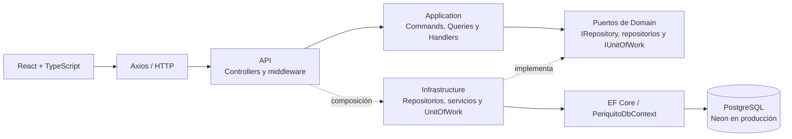

# PeriquitoManagement

Sistema web para administrar la operación del Restaurante Periquito. Reúne en una API ASP.NET Core y una interfaz React la gestión de categorías, platos, mesas, pedidos, ventas, usuarios, inventario y reportes.

- **Backend:** ASP.NET Core 10 y PostgreSQL.
- **Frontend:** React, Vite y TypeScript.
- **Producción:** Render y Neon.
- **Autor:** Julio Torres.

## Problemática

La operación del restaurante necesita mantener coordinados los datos de mesas, pedidos, platos, ventas e insumos. Cuando estas tareas se gestionan por separado, es más difícil consultar el estado de una mesa, dar seguimiento a un pedido, conservar los importes históricos o revisar los resultados de ventas e inventario.

## Propuesta de solución

PeriquitoManagement centraliza estas operaciones en una aplicación web con permisos diferenciados para Administrador y Mesero. Una API organizada por capas aplica las reglas de negocio y persiste los datos en PostgreSQL; el frontend ofrece un panel para cada rol y consulta la API mediante HTTP.

## Objetivos

### Objetivo general

Desarrollar un sistema para centralizar y facilitar la gestión operativa del Restaurante Periquito, con información persistente y acceso controlado por roles.

### Objetivos específicos

- Administrar categorías, platos, mesas y cuentas de usuario.
- Registrar pedidos y completar ventas conservando precios y costos históricos.
- Controlar insumos y movimientos de inventario.
- Presentar indicadores administrativos y exportar reportes de ventas a Excel.
- Permitir al personal Mesero atender mesas y pedidos sin acceder a costos ni operaciones administrativas.
- Mantener separadas las reglas de aplicación, el dominio, la persistencia y la interfaz de usuario.

## Funcionalidades

### Administrador

- Consultar el dashboard con ventas, ganancias, costos, pedidos, mesas, inventario y platos más vendidos para un rango de fechas.
- Crear, editar, consultar y eliminar categorías, platos, mesas e insumos, sujeto a las relaciones e historial existentes.
- Activar o desactivar platos.
- Consultar pedidos, sus detalles y datos de costo.
- Consultar ventas, incluyendo mesa, mesero, platos, precios y costos históricos.
- Registrar entradas y salidas de inventario, consultar movimientos y detectar insumos con stock bajo.
- Crear y administrar usuarios con roles Administrador o Mesero.
- Descargar el reporte de ventas en formato Excel.

### Mesero

- Consultar categorías, carta de platos y precios de venta, sin recibir costos en esos DTOs.
- Consultar mesas, mesas disponibles, pedidos activos y pedidos asociados a una mesa.
- Abrir pedidos, agregar o ajustar platos, quitar elementos, cancelar pedidos y completar la venta.
- Consultar su perfil de sesión.

## Tecnologías

| Área | Tecnologías |
|---|---|
| API | .NET 10, ASP.NET Core Web API, C# |
| Persistencia | Entity Framework Core 10, Npgsql 10, PostgreSQL |
| Aplicación | MediatR 12.5.0 |
| Autenticación | JWT Bearer, `PasswordHasher<TUser>` de ASP.NET Core Identity |
| Documentación de API | Swashbuckle.AspNetCore 10.3.1 (Swagger UI en Development) |
| Excel | ClosedXML 0.105.1 |
| Frontend | React 19, Vite 8, TypeScript 7 |
| Interfaz | Tailwind CSS 4, React Router 7, Lucide React, Recharts, Sonner |
| HTTP | Axios |
| Contenedores y hosting | Docker multi-stage, Render |
| Base de datos administrada | Neon PostgreSQL |

Las versiones corresponden a los archivos de proyecto y manifiestos incluidos en este repositorio.

## Arquitectura hexagonal

El backend separa las reglas y los adaptadores. El dominio contiene entidades, constantes y puertos de persistencia; Application agrupa casos de uso, DTOs e interfaces; Infrastructure implementa repositorios, servicios y persistencia; Api expone HTTP y ensambla las dependencias. La API es el punto de composición y referencia Application e Infrastructure. Infrastructure referencia Domain y Application para implementar los puertos correspondientes.



### Patrones y flujo de aplicación

- **Repository:** las interfaces se declaran en Domain y sus implementaciones concretas consultan y modifican PostgreSQL desde Infrastructure. Los repositorios especializados añaden consultas de categorías, usuarios, pedidos, ventas, mesas e inventario.
- **UnitOfWork:** coordina `SaveChangesAsync` y transacciones explícitas; los casos de uso que necesitan atomicidad confirman o revierten la transacción.
- **Commands, Queries y Handlers:** MediatR dirige cada solicitud a su Handler. Los Commands modifican el estado; los Queries devuelven proyecciones DTO. Los grupos funcionales se encuentran en `Application/UseCases`.
- **Controllers:** validan el contrato HTTP, aplican autorización y delegan la operación a MediatR. No acceden directamente al `DbContext`.
- **Middleware:** `ExceptionMiddleware` produce respuestas `ProblemDetails`; `RequestLoggingMiddleware` registra método, plantilla de ruta, código HTTP y duración, sin registrar cuerpos de solicitud ni credenciales.

### Estructura del repositorio

```text
PeriquitoManagement/
├── PeriquitoManagement.Api/
│   ├── Configuration/
│   ├── Controllers/
│   ├── Middleware/
│   ├── Program.cs
│   └── PeriquitoManagement.Api.http
├── PeriquitoManagement.Application/
│   ├── DTOs/
│   ├── Exceptions/
│   ├── Interfaces/
│   └── UseCases/
├── PeriquitoManagement.Domain/
│   ├── Constants/
│   ├── Entities/
│   ├── Interfaces/
│   └── ReadModels/
├── PeriquitoManagement.Infrastructure/
│   ├── Persistence/
│   ├── Repositories/
│   └── Services/
├── database/
│   ├── schema.sql
│   ├── seed.sql
│   ├── seed-production.sql
│   ├── verify-production.sql
│   └── queries.sql
├── periquito-frontend/
│   └── src/
│       ├── components/
│       ├── context/
│       ├── hooks/
│       ├── layouts/
│       ├── pages/admin/
│       ├── pages/waiter/
│       ├── routes/
│       ├── services/
│       ├── types/
│       └── utils/
├── Dockerfile
├── .dockerignore
├── render.yaml
└── PeriquitoManagement.sln
```

## Datos y modelo entidad-relación

La base sigue un enfoque **Database First**: `database/schema.sql` define las tablas, restricciones, índices, función y trigger; las entidades y `PeriquitoDbContext` representan ese esquema en EF Core. Las diez tablas son `roles`, `users`, `categories`, `dishes`, `tables`, `orders`, `order_details`, `sales`, `ingredients` e `inventory_movements`.

```mermaid
erDiagram
    ROLES ||--o{ USERS : asigna
    USERS ||--o{ ORDERS : atiende
    TABLES o|--o{ ORDERS : recibe
    CATEGORIES ||--o{ DISHES : clasifica
    ORDERS ||--o{ ORDER_DETAILS : contiene
    DISHES ||--o{ ORDER_DETAILS : aparece_en
    ORDERS ||--o| SALES : genera
    INGREDIENTS ||--o{ INVENTORY_MOVEMENTS : registra
    USERS o|--o{ INVENTORY_MOVEMENTS : efectua

    ROLES {
        bigint id PK
        varchar name UK
    }
    USERS {
        bigint id PK
        bigint role_id FK
        varchar full_name
        varchar username UK
        varchar password_hash
        boolean is_active
        timestamptz created_at
    }
    CATEGORIES {
        bigint id PK
        varchar name UK
        boolean is_active
    }
    DISHES {
        bigint id PK
        bigint category_id FK
        varchar name UK
        varchar description
        numeric price
        numeric cost
        boolean is_available
    }
    TABLES {
        bigint id PK
        smallint table_number UK
        smallint capacity
        varchar status
    }
    ORDERS {
        bigint id PK
        bigint table_id FK
        bigint waiter_id FK
        timestamptz ordered_at
        timestamptz closed_at
        varchar status
        numeric total
        varchar notes
    }
    ORDER_DETAILS {
        bigint id PK
        bigint order_id FK
        bigint dish_id FK
        integer quantity
        numeric unit_price
        numeric unit_cost
        numeric subtotal
    }
    SALES {
        bigint id PK
        bigint order_id FK_UK
        timestamptz sold_at
        numeric total_amount
        numeric gross_profit
    }
    INGREDIENTS {
        bigint id PK
        varchar name UK
        varchar unit_of_measure
        numeric current_stock
        numeric minimum_stock
        boolean is_active
    }
    INVENTORY_MOVEMENTS {
        bigint id PK
        bigint ingredient_id FK
        bigint user_id FK
        varchar movement_type
        numeric quantity
        timestamptz occurred_at
        varchar reason
    }
```

Los pedidos conservan `unit_price` y `unit_cost` al agregarse un plato, y el detalle calcula su subtotal con el precio histórico. Una venta se relaciona de manera única con el pedido completado. Los movimientos de inventario quedan registrados en `inventory_movements`; el trigger de PostgreSQL ajusta el stock y rechaza una salida que lo dejaría por debajo de cero.

## Autenticación, roles y seguridad

- `POST /api/auth/login` valida que la cuenta exista, esté activa y tenga contraseña correcta; la API emite un JWT firmado con identificador, nombre de usuario y rol.
- `GET /api/auth/me` devuelve la identidad del token actual.
- Las contraseñas se guardan como hashes generados y verificados con `PasswordHasher<User>`; no se almacenan en texto plano.
- Los roles de la base son `Administrador` y `Mesero`. La API impone autorización además de las rutas protegidas del frontend.
- Los endpoints de ventas, dashboard, reportes, usuarios e inventario restringen sus consultas sensibles al Administrador. El Mesero no recibe campos de costo en los DTOs de platos y pedidos.
- El token del frontend se conserva solo en memoria: se pierde al recargar o cerrar la página. No se persiste en `localStorage`.
- CORS admite el origen del frontend configurado para el servicio; no se recomienda usar comodines en producción.
- Las excepciones internas no se devuelven al cliente. Las respuestas de error utilizan `ProblemDetails` y estados HTTP apropiados.

Los secretos se suministran mediante **User Secrets** en desarrollo o variables de entorno en Render. No se deben guardar en Git, `appsettings.json`, `render.yaml`, Dockerfile ni variables `VITE_*`.

## API: endpoints principales

La API usa el prefijo `/api`. Salvo los endpoints de autenticación indicados y `GET /api/health`, se requiere un JWT Bearer. Los endpoints no listados por método permanecen sujetos a los atributos de autorización descritos a continuación.

| Método y ruta | Acceso | Propósito |
|---|---|---|
| `GET /api/health` | Público | Comprueba que la API puede conectarse a PostgreSQL. |
| `POST /api/auth/login` | Público | Recibe `username` y `password`; devuelve JWT y usuario autenticado. |
| `GET /api/auth/me` | Usuario autenticado | Devuelve la identidad y rol del token. |
| `GET /api/categories`, `GET /api/categories/{id}` | Administrador, Mesero | Consulta categorías. |
| `POST /api/categories`, `PUT /api/categories/{id}`, `DELETE /api/categories/{id}` | Administrador | Mantiene categorías. |
| `GET /api/dishes`, `GET /api/dishes/{id}` | Administrador, Mesero | Consulta carta; acepta `categoryId` e `isAvailable`. La respuesta del Mesero omite el costo. |
| `POST /api/dishes`, `PUT /api/dishes/{id}`, `PATCH /api/dishes/{id}/availability`, `DELETE /api/dishes/{id}` | Administrador | Mantiene platos y disponibilidad. |
| `GET /api/tables`, `/api/tables/available`, `/api/tables/occupied`, `GET /api/tables/{id}` | Administrador, Mesero | Consulta mesas y filtra por estado. |
| `POST /api/tables`, `PUT /api/tables/{id}`, `DELETE /api/tables/{id}` | Administrador | Mantiene mesas. |
| `GET /api/orders`, `/api/orders/active`, `GET /api/orders/{id}`, `GET /api/orders/tables/{tableId}/active` | Administrador, Mesero | El Mesero consulta pedidos activos; el Administrador también puede consultar historial y DTOs administrativos. |
| `POST /api/orders`, `POST /api/orders/{id}/items`, `PUT /api/orders/{id}/items/{dishId}`, `DELETE /api/orders/{id}/items/{dishId}`, `POST /api/orders/{id}/cancel` | Administrador, Mesero | Abre y gestiona pedidos activos. |
| `POST /api/sales/orders/{orderId}/complete` | Administrador, Mesero | Completa el pedido y registra la venta. |
| `GET /api/sales`, `GET /api/sales/{id}` | Administrador | Consulta ventas, importes, costos, mesa, mesero y detalles históricos. Admite `fromUtc` y `toUtc`. |
| `GET /api/ingredients`, `/api/ingredients/low-stock`, `GET /api/ingredients/{id}`, `POST /api/ingredients`, `PUT /api/ingredients/{id}`, `DELETE /api/ingredients/{id}` | Administrador | Consulta y mantiene insumos. |
| `GET /api/inventory/movements` | Administrador | Consulta movimientos; admite ingrediente, tipo y rango de fechas UTC. |
| `POST /api/inventory/ingredients/{id}/entries`, `POST /api/inventory/ingredients/{id}/exits` | Administrador | Registra entradas y salidas de inventario. |
| `GET /api/dashboard` | Administrador | Devuelve indicadores para `fromDate` y `toDate`. |
| `GET /api/reports/sales.xlsx` | Administrador | Descarga el reporte Excel; admite `fromDate` y `toDate`. |
| `GET /api/users`, `GET /api/users/{id}`, `POST /api/users`, `PUT /api/users/{id}`, `DELETE /api/users/{id}` | Administrador | Consulta, crea, actualiza o desactiva usuarios. |

Los errores de validación, autenticación, autorización, ausencia de recurso y conflicto se expresan mediante códigos HTTP `400`, `401`, `403`, `404` y `409`, según el caso. Los ejemplos editables de solicitudes están en `PeriquitoManagement.Api/PeriquitoManagement.Api.http`.

## Reglas de negocio destacadas

- Se valida que las categorías, platos, mesas, insumos y usuarios cumplan longitudes, formatos, estados y relaciones del esquema.
- No se pueden crear pedidos para mesas no disponibles o que ya tengan otro pedido activo. Un índice parcial refuerza la unicidad de pedido activo por mesa.
- Solo se pueden añadir al pedido platos disponibles. Las cantidades deben ser positivas y los importes respetan los límites numéricos de PostgreSQL.
- El cierre requiere un pedido activo con detalles, genera como máximo una venta, conserva importes históricos y libera la mesa. No se permite completar la venta si el beneficio bruto calculado es negativo.
- No se permite eliminar categorías, platos, mesas o insumos cuando las relaciones o el historial lo impiden; se pueden desactivar los registros que admiten esa operación.
- No se puede desactivar ni cambiar de rol al último Administrador activo.
- Las salidas de inventario requieren stock suficiente. El trigger SQL es responsable de actualizar `current_stock` al insertar el movimiento.
- Los costos y ganancias quedan accesibles únicamente para operaciones administrativas.

## Reportes Excel

`GET /api/reports/sales.xlsx` produce un archivo `.xlsx` con tres hojas: **Resumen**, **Ventas** y **Productos**. Incluye ingresos, costo, ganancia bruta, número de ventas y cantidades por plato; en ventas muestra mesa, usuario Mesero y fecha convertida a hora de Perú. La función está restringida al rol Administrador.

## Capturas de pantalla

Este repositorio todavía no incluye capturas del sistema. Esta sección queda reservada para incorporar imágenes reales del inicio de sesión y de los paneles cuando se agreguen al repositorio; no se incluyen enlaces ni recursos gráficos ficticios.

## Configuración del entorno local

### Requisitos

- SDK de .NET 10.
- Node.js y npm compatibles con las versiones fijadas en `periquito-frontend/package-lock.json`.
- PostgreSQL accesible desde la API.

### Base de datos local

Para una base nueva de desarrollo, ejecutar desde un cliente PostgreSQL:

1. `database/schema.sql`
2. `database/seed.sql` (datos de desarrollo)

El script de producción es diferente: para inicializar un entorno de producción vacío se usa primero `schema.sql`, luego `seed-production.sql` y finalmente `verify-production.sql`. No ejecutes de nuevo el esquema sobre una base que ya tiene tablas ni uses los datos de prueba locales como datos de producción.

### Secretos del backend

En la carpeta `PeriquitoManagement.Api`, configura los valores locales mediante User Secrets. Sustituye los marcadores por valores de tu propio entorno; no los copies al código ni los publiques:

```powershell
Set-Location PeriquitoManagement.Api
dotnet user-secrets set "ConnectionStrings:DefaultConnection" "<cadena-local-de-PostgreSQL>"
dotnet user-secrets set "Jwt:Key" "<secreto-aleatorio-de-al-menos-32-bytes>"
dotnet user-secrets set "Jwt:Issuer" "PeriquitoManagement"
dotnet user-secrets set "Jwt:Audience" "PeriquitoManagementFrontend"
dotnet user-secrets set "Jwt:ExpirationMinutes" "30"
dotnet user-secrets set "Cors:AllowedOrigins:0" "http://localhost:5173"
```

Para habilitar el aprovisionamiento local inicial, configura temporalmente `BootstrapUsers:Enabled`, `BootstrapUsers:Administrator:Username`, `BootstrapUsers:Administrator:FullName`, `BootstrapUsers:Administrator:Password`, `BootstrapUsers:Waiter:Username`, `BootstrapUsers:Waiter:FullName` y `BootstrapUsers:Waiter:Password` en User Secrets. Las contraseñas de bootstrap deben tener entre 12 y 128 caracteres. El proceso usa el servicio de hashing existente y omite las cuentas que ya existen. Una vez creadas, deshabilita `BootstrapUsers:Enabled` y elimina los secretos de contraseñas iniciales.

### Ejecutar API y frontend

En una terminal, desde la raíz:

```powershell
dotnet build PeriquitoManagement.sln
dotnet run --project PeriquitoManagement.Api --launch-profile http
```

La API local escucha en `http://localhost:5169`. Swagger UI está habilitado únicamente en Development en `/swagger`.

En otra terminal:

```powershell
cd periquito-frontend
npm ci
Copy-Item .env.example .env
npm run dev
```

El `.env.example` deja `VITE_API_URL` vacío para usar el proxy relativo `/api` y configura `VITE_API_PROXY_TARGET=http://localhost:5169`. Los archivos `.env` están excluidos de Git. Abre Vite en `http://localhost:5173`.

## Docker, Render y Neon

### Docker

El `Dockerfile` de la raíz compila la solución en una etapa SDK oficial .NET 10 y publica la API en una imagen ASP.NET 10. `.dockerignore` excluye contenido local innecesario. Para construir la imagen desde la raíz:

```powershell
docker build -t periquito-management-api .
```

La aplicación escucha en el puerto `PORT` provisto por el entorno Render y tiene habilitado el manejo de cabeceras reenviadas para el proxy HTTPS.

### Render

`render.yaml` declara el backend como Web Service Docker gratuito y el frontend como Static Site. El sitio estático publica `periquito-frontend/dist` y reescribe rutas a `index.html` para React Router.

Configura en el Web Service estas variables; los valores secretos deben configurarse directamente en Render:

| Variable | Uso |
|---|---|
| `ASPNETCORE_ENVIRONMENT` | `Production` |
| `ASPNETCORE_FORWARDEDHEADERS_ENABLED` | Habilita el tratamiento de HTTPS tras el proxy. |
| `ConnectionStrings__DefaultConnection` | Secreto con la conexión a PostgreSQL de Neon y SSL requerido. |
| `Jwt__Key` | Secreto de firma JWT de al menos 32 bytes. |
| `Jwt__Issuer` | Emisor configurado para el token. |
| `Jwt__Audience` | Audiencia configurada para el token. |
| `Jwt__ExpirationMinutes` | Tiempo de vida del token; el despliegue usa 30 minutos. |
| `Cors__AllowedOrigins__0` | Origen exacto del frontend público. |
| `BootstrapUsers__Enabled` | Debe quedar `false` después del aprovisionamiento inicial. |

La configuración de bootstrap también reconoce `BootstrapUsers__Administrator__Username`, `BootstrapUsers__Administrator__FullName`, `BootstrapUsers__Administrator__Password`, `BootstrapUsers__Waiter__Username`, `BootstrapUsers__Waiter__FullName` y `BootstrapUsers__Waiter__Password`. No mantengas las variables de contraseña después de aprovisionar las cuentas. En `render.yaml` las variables manuales usan `sync: false` para que el Blueprint no las sobrescriba.

En el Static Site, configura `VITE_API_URL` con el origen del backend más el prefijo `/api`, sin credenciales. Es una variable pública de compilación; nunca coloques secretos en una variable `VITE_*`.

### Neon PostgreSQL

La aplicación usa PostgreSQL administrado por Neon. La variable de conexión se carga al iniciar la API; el código desactiva GSSAPI para mantener compatibilidad con el contenedor, respetando el modo SSL configurado en la cadena. Mantén la cadena completa como secreto de Render y conéctate a la base de producción `neondb` de la rama `production`.

Para inicializar una base vacía de producción, el orden de scripts es `database/schema.sql`, `database/seed-production.sql` y `database/verify-production.sql`. El seed de producción prepara roles y catálogo inicial, no copia el historial local de pedidos/ventas ni crea contraseñas de producción. El bootstrap de la aplicación o la administración segura de usuarios se encarga de las cuentas; no guardes contraseñas en scripts versionados. La base de datos Neon actualmente utilizada ya fue inicializada y no requiere volver a ejecutar el esquema.

### URLs públicas

- **Frontend:** [https://periquito-frontend.onrender.com](https://periquito-frontend.onrender.com)
- **Backend:** [https://periquito-api.onrender.com](https://periquito-api.onrender.com)
- **Health de PostgreSQL:** [https://periquito-api.onrender.com/api/health](https://periquito-api.onrender.com/api/health)

## Verificación ejecutada

Resultados verificados en el estado del proyecto al 25 de noviembre de 2026:

| Verificación | Resultado |
|---|---|
| `dotnet build PeriquitoManagement.sln` | Correcto: 0 advertencias y 0 errores. |
| `npm run build` | Correcto: TypeScript y Vite finalizaron; 2,851 módulos transformados. |
| `GET /api/health` en producción | Respondió `{"status":"connected"}` desde la API pública. |
| Login de Administrador | Correcto; redirigió al dashboard administrativo. |
| Login de Mesero | Correcto; redirigió al panel de mesas. |
| Operación de API y paneles | Las pruebas manuales de módulos desde Swagger y ambos paneles fueron reportadas como satisfactorias durante la validación del proyecto. |
| Pruebas automatizadas | No se encontró un proyecto de pruebas automatizadas en esta solución. |

Estas comprobaciones son una fotografía del despliegue y dependen de la disponibilidad de Render y Neon.

## Limitaciones del alojamiento gratuito

Los niveles gratuitos sirven para demostraciones y uso de bajo volumen, pero no ofrecen la misma disponibilidad ni recursos que una infraestructura de producción dedicada:

- Render puede suspender el Web Service después de 15 minutos sin tráfico; la primera petición posterior puede tardar cerca de un minuto en despertar el servicio. El sistema de archivos de una instancia gratuita es efímero.
- Las instancias gratuitas de Render tienen límites de CPU, memoria, horas mensuales compartidas, ancho de banda y minutos de compilación. La Static Site no duerme, pero comparte cuotas de uso de la cuenta.
- Neon aplica cuotas por proyecto para cómputo y almacenamiento y suspende el cómputo cuando permanece inactivo. Se debe vigilar el uso y confirmar las cuotas vigentes en el panel.
- Los límites, cuotas y condiciones pueden cambiar. Revisa la [documentación de Render sobre planes gratuitos](https://render.com/docs/free) y la [información vigente del plan gratuito de Neon](https://neon.com/blog/neon-free-plan-1-gb-per-project).

## Conclusiones

PeriquitoManagement integra los principales flujos de operación del restaurante en un frontend web y una API con persistencia PostgreSQL. La separación por capas, los casos de uso MediatR, los repositorios, las transacciones del UnitOfWork y la autorización JWT mantienen organizadas las responsabilidades. La solución está desplegada en Render y Neon; por las limitaciones de los niveles gratuitos, su uso debe acompañarse de vigilancia de cuotas y no sustituye un servicio con SLA, respaldos y capacidad dedicada.
